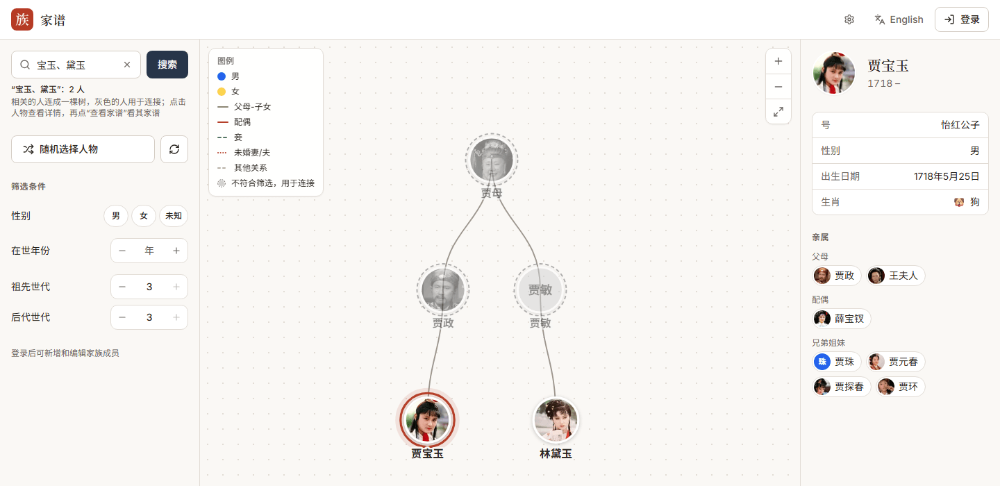

# Family Relationship Visualizer

A web app for building and viewing family trees, labelled with Chinese kinship terms. Built with Next.js 16 and D3.js, it stores data in Google Firestore and runs on Google Cloud Run.

## Live Service

The app runs at https://family-tree.pythoner.work. Anyone can browse its public persons; sign in with Google or GitHub to add your own. Its MCP endpoint for AI agents is https://family-tree.pythoner.work/api/mcp.



## Features

- Sign in with Google or GitHub; link both to one account on the account page (click your name at the top right), or sign in with one whose verified email matches. Linking a sign-in method of another account offers to merge that account into yours. You can change only the persons and relationships you created; private persons are visible only to you.
- The tree shows the selected person and their relatives 0–3 generations up and down (default 3), one row per generation.
- Relatives within 四代 (up to great-grandparents and great-grandchildren, and relatives sharing an ancestor no further back) show their Chinese kinship term, from [relationship.js](https://github.com/mumuy/relationship) plus the app's terms for wives and concubines (主母, 庶母 …) and step-parents (继母). A wife calls her husband's wider family as he does. Where birth dates do not tell elder from younger, both terms show (伯父/叔父); a parent's siblings are numbered by birth (大姨母, 二姨母, 小姨母). The gear button at the top right chooses formal (父亲, 祖父; the default) or casual terms (爸爸, 爷爷), and southern (外公) or northern (姥爷).
- Relationship types: parent–child, sibling, half sibling, spouse, concubine, betrothed, adoptive parent, foster parent, sworn sibling; dates may include month and day.
- A man's wives, concubines and betrothed stand beside him by start date, with solid, dashed and dotted lines; marriages are numbered when at least two have a start date.
- Avatars from photos (JPEG, PNG, GIF or WebP, up to 10MB), cropped to the middle square; for a group photo, Gemini finds the faces, and unused faces can be saved for later.
- Import from text or scans (up to 6 images or PDFs, 20MB in total): Gemini extracts persons and relationships for you to review.
- A person can also have a 字, a 号 and other names (香菱 for 甄英莲), which search uses, a description and a web link (Wikipedia and 百度百科 show their icon).
- Duplicate public persons are refused: the same name, or one matching another's 字, 号 or other names, with birth dates that do not differ (王氏-style names need the same birth year).
- AI agents can read and change the tree through MCP (see below).

## Run Locally

Requires Node.js 22.22+, a Google Cloud project with a Firestore database in Native mode, a Google OAuth client and a GitHub OAuth app. A Gemini API key is optional locally.

```bash
npm install
cp .env.local.example .env.local   # fill in the values; each is described in the file
npm run dev                        # http://localhost:3000
npm test                           # tests; kinship terms of generated families are kept in src/lib/__tests__/__snapshots__/kinship-chains.txt
npm run kinship:table              # regenerate the kinship term table from relationship.js (about 6 minutes)
```

**Firestore:** create a service account with the Datastore Owner role, download its JSON key and set `GOOGLE_APPLICATION_CREDENTIALS` to that key's path. `GOOGLE_CLOUD_PROJECT` must be the project the key belongs to.

**Google sign-in:** in Google Cloud Console → APIs & Services → Credentials, create an OAuth client ID of type "Web application". Add the app's URL as an authorized JavaScript origin and `<NEXTAUTH_URL>/api/auth/callback/google` as a redirect URI, e.g. `http://localhost:3000` and `http://localhost:3000/api/auth/callback/google`.

**GitHub sign-in:** at GitHub → Settings → Developer settings → OAuth Apps, create an app with the app's URL as homepage and `<NEXTAUTH_URL>/api/auth/callback/github` as callback URL, then set `GITHUB_CLIENT_ID` and `GITHUB_CLIENT_SECRET`. A GitHub OAuth app has one callback URL, so use separate apps for local and deployed sites.

**Without a Gemini key:** a group photo gives one avatar from the middle of the photo, and importing from text or scans fails. Everything else works. When a Gemini call fails, the app names the cause: credits or billing used up, quota or rate limit, missing or invalid key, Gemini down, or Gemini unreachable.

**Environment variables** already set in your shell or system (e.g. a user-level `GOOGLE_CLOUD_PROJECT`) take precedence over `.env.local`.

**Behind an HTTP proxy:** Google sign-in and Gemini requests ignore `HTTPS_PROXY` unless `NODE_USE_ENV_PROXY=1` is also set; set `NO_PROXY=localhost,127.0.0.1,::1` as well. Firestore uses `HTTPS_PROXY` without it.

## Deploy

On each push to `main`, Cloud Build builds the app and deploys it to Cloud Run in `us-central1` using [cloudbuild.yaml](cloudbuild.yaml). The Firestore database is in the `nam5` multi-region (central US), so the app runs next to it: every save and load makes several round trips to Firestore. One-time setup:

1. Enable the APIs:
   ```bash
   gcloud services enable cloudbuild.googleapis.com run.googleapis.com secretmanager.googleapis.com
   ```
2. Store the secrets as one JSON secret named `family-tree-app-secrets`:
   ```bash
   echo -n '{"AUTH_SECRET":"...","GOOGLE_CLIENT_SECRET":"...","GITHUB_CLIENT_SECRET":"...","GOOGLE_AI_API_KEY":"..."}' \
     | gcloud secrets create family-tree-app-secrets --data-file=-
   ```
3. Grant the Cloud Build service account its roles:
   ```bash
   PROJECT_NUMBER=$(gcloud projects describe $PROJECT_ID --format='value(projectNumber)')
   CLOUD_BUILD_SA="$PROJECT_NUMBER@cloudbuild.gserviceaccount.com"

   gcloud projects add-iam-policy-binding $PROJECT_ID \
     --member="serviceAccount:$CLOUD_BUILD_SA" \
     --role="roles/run.admin"

   gcloud projects add-iam-policy-binding $PROJECT_ID \
     --member="serviceAccount:$CLOUD_BUILD_SA" \
     --role="roles/iam.serviceAccountUser"

   gcloud projects add-iam-policy-binding $PROJECT_ID \
     --member="serviceAccount:$CLOUD_BUILD_SA" \
     --role="roles/secretmanager.secretAccessor"
   ```
4. Connect the GitHub repository and create the trigger (or do this in Cloud Console → Cloud Build → Triggers):
   ```bash
   gcloud builds connections create github family-tree-connection \
     --region=us-west1

   gcloud builds repos create family-tree-repo \
     --connection=family-tree-connection \
     --repo-name=your-github-repo-name \
     --region=us-west1

   gcloud builds triggers create github \
     --name="family-tree-deploy" \
     --region=us-west1 \
     --repo-name=your-github-repo-name \
     --repo-owner=your-github-username \
     --branch-pattern="^main$" \
     --build-config=cloudbuild.yaml
   ```
5. In `cloudbuild.yaml`, set `NEXTAUTH_URL` to the deployed URL, `GOOGLE_CLIENT_ID` to the Google OAuth client ID and `GITHUB_CLIENT_ID` to the GitHub OAuth app's client ID:
   ```yaml
   - 'GOOGLE_CLOUD_PROJECT=$PROJECT_ID,NEXTAUTH_URL=https://your-cloud-run-url.a.run.app,GOOGLE_AI_MODEL=gemini-3.5-flash-lite,GOOGLE_CLIENT_ID=your-client-id.apps.googleusercontent.com,GITHUB_CLIENT_ID=your-github-client-id,GOOGLE_AI_MODEL=gemini-3.5-flash-lite'
   ```
   Then add that URL and its `/api/auth/callback/google` redirect URI to the Google OAuth client, and register `<deployed URL>/api/auth/callback/github` as the GitHub OAuth app's callback URL.
6. Let Firestore delete expired one-time avatar upload links (usually within 24 hours of expiry):
   ```bash
   gcloud firestore fields ttls update expiresAt --collection-group=AvatarUpload --enable-ttl
   ```
7. Turn off indexing of the stored data, which is never queried (saves index storage and write time):
   ```bash
   gcloud firestore indexes fields update data --collection-group=PersonBucket --disable-indexes
   gcloud firestore indexes fields update data --collection-group=RelationshipBucket --disable-indexes
   gcloud firestore indexes fields update image --collection-group=PersonAvatar --disable-indexes
   ```

## Usage

- Signed in, the sidebar offers **Add Person**, **Add Relationship**, **Add a Family**, **Import from text or scans** and **Avatars from a group photo**. **Add a Family** creates two parents, up to three children and their relationships at once; persons picked from the tree, or typed names matching exactly one person, are not created again.
- Each person has an address, `/person/<id>`: refresh, bookmark or share it, and Back returns to the person before. Link previews show a public person's name, years and avatar, and nothing about a private one.
- Click a person to select them; double-click one you created to edit them. The right panel shows their details and relatives, and lets you add or change their relationships, merge another of your persons into them, or delete them.
- Search (Enter or **Search**) finds persons by name, 字, 号 (also after the surname: 蒋介石 for 蒋中正) or other names; several names separated by 、 or commas keep only families where all are found. Matches show as a forest, related ones joined through faded persons, at most 100; a single match opens their family tree, and **查看家谱** opens a chosen match's. Back returns to the results.
- The gender and "living in year" filters also narrow search results; persons needed to keep the tree connected are shown faded.
- The reload button beside **Random person** loads the latest data, keeping the selected person.
- Point at a person to highlight their lines; drag to pan, scroll or +/− to zoom, the third button to see everything.
- On screens narrower than 1024px, the header button opens the sidebar and the bottom bar the details panel.

## AI Agents (MCP)

AI assistants can read and change the family tree through MCP at `<site URL>/api/mcp`, acting as you with the same rules as the website: they see public persons and yours, change only persons and relationships you created, and are refused duplicate public persons.

1. Signed in, click your name at the top right, open **API tokens** and create a token. It is shown once; up to 10 per user. Revoking one stops it within a minute.
2. Add the server to the client with the token as a Bearer header, e.g. for Claude Code, in your project folder:
   ```bash
   claude mcp add --scope project --transport http family-tree <site URL>/api/mcp --header "Authorization: Bearer <token>"
   ```
   This saves the token in the folder's `.mcp.json`; never commit or share that file.

Each token may make 60 calls a minute and 2,000 a day; of these, 20 a minute and 500 a day may change data (`create_…`, `update_…`, `delete_…`, `merge_…`, `set_…`, `remove_…`, `add_…`, `assign_…`). An address that sends a missing or wrong token 10 times in a minute is refused for the rest of that minute. A refused call gets HTTP 429 with `Retry-After`. Each server instance counts separately, and Cloud Run runs at most two.

Tools:
- Persons: `search_persons`, `get_person`, `create_person`, `update_person`, `merge_persons`, `delete_person`.
- Relationships: `create_relationship`, `update_relationship`, `delete_relationship`, `get_kinship_term` (what one person calls another, e.g. 堂兄).
- Avatars: `get_person_avatar`, `set_person_avatar`, `remove_person_avatar`, `create_photo_upload_link`.
- Saved faces (not given to anyone yet): `list_saved_faces`, `add_saved_face`, `assign_saved_face`, `delete_saved_face`.

A face photo (JPEG, PNG, GIF or WebP, up to 10MB) is cropped like an upload in the person form and becomes a person's avatar or a saved face:
- From the web: `set_person_avatar` (a person's avatar) and `add_saved_face` (a saved face) take an `https://` address; the server fetches only public addresses.
- From a local file: `create_photo_upload_link` returns a `curl` command with a one-time upload link (one upload, valid for 10 minutes, no API token in it); the agent runs it with the file path filled in. With a `personId` the photo becomes that person's avatar; without one, a saved face.

## Open Items

| Item | Status |
|------|--------|
| Families (`Family` entity, `/api/families`) | Not built |
| Export | Not built |
| Avatars uploaded before face cropping | Stored as the original photos |
| Relationship-type and branch filters | Not built |
| Relationship dialogs: layout redesign and remaining hard-coded Chinese texts | Not done |
| Dark theme | Tokens exist; no toggle |
| Zustand store (`src/store/index.ts`) | Unused; state lives in the page |

## License

MIT. See [LICENSE](LICENSE).
