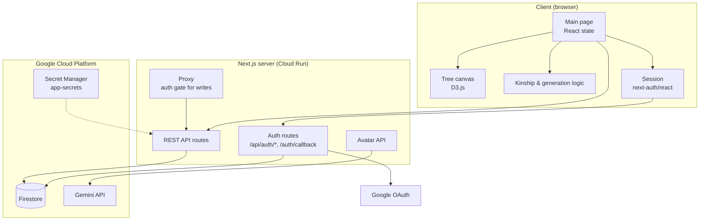
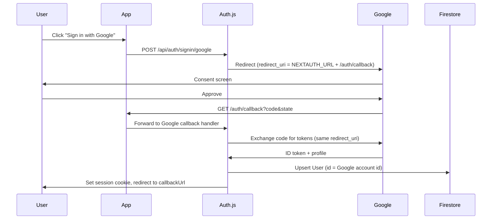
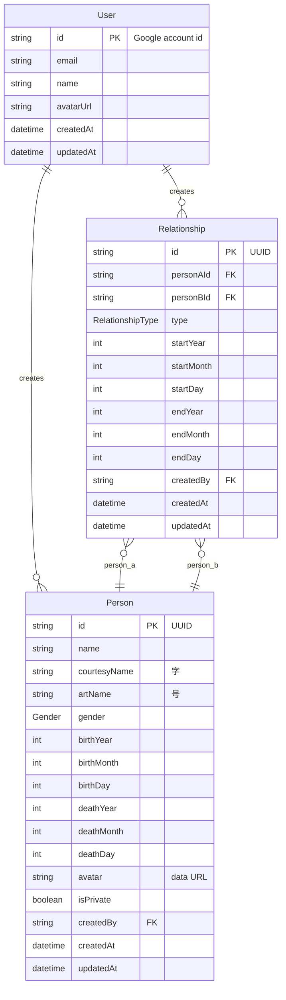
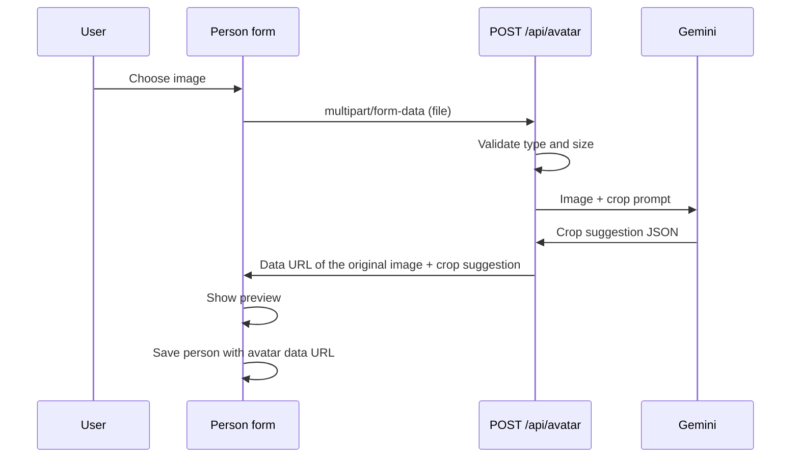

# Family Relationship Visualizer - Architecture & UI Specification

> **Version:** 1.1
> **Supersedes:** [v1.0](relationship-visualizer-spec-v1.0.md)
> **Document Type:** OpenSpec Technical Specification
> **Target Application:** Complex Family Relationship Visualization
> **Reference Domain:** "A Dream in Red Mansions" (红楼梦) Jia Family Tree

This version describes the application as built. Items from v1.0 that are not built are listed in [11.2](#112-open-items).

---

## Table of Contents

1. [Executive Summary](#1-executive-summary)
2. [System Architecture Overview](#2-system-architecture-overview)
3. [Authentication & Authorization](#3-authentication--authorization)
4. [Data Model Schema](#4-data-model-schema)
5. [Avatar & Image Processing](#5-avatar--image-processing)
6. [Visualization Logic](#6-visualization-logic)
7. [Component Specifications](#7-component-specifications)
8. [UI/UX Design Guidelines](#8-uiux-design-guidelines)
9. [API Endpoints Design](#9-api-endpoints-design)
10. [Google Cloud Deployment](#10-google-cloud-deployment)
11. [Implementation Roadmap](#11-implementation-roadmap)
12. [Appendices](#12-appendices)

---

## 1. Executive Summary

### 1.1 Project Overview

The Family Relationship Visualizer is a web application for modelling, visualizing and editing family relationship structures. It is designed around the relationships of traditional Chinese families, such as the Jia family in "A Dream in Red Mansions" (红楼梦), including Chinese kinship terms.

### 1.2 Key Features

| Feature | Description |
|---------|-------------|
| **Google Authentication** | Sign in with a Google account (OAuth 2.0 / OpenID Connect) |
| **Privacy Controls** | Mark persons as private (visible only to their creator) |
| **Relative Generation** | Generation numbers computed relative to the selected person |
| **Centered Visualization** | Selected person at the center, with 0–3 generations shown above and below (default 3) |
| **Kinship Terms** | Every person in the tree is labelled with their Chinese kinship term (父亲, 堂哥, …) relative to the selected person |
| **Gender-Specific Colors** | Blue gradient for males, yellow/gold gradient for females, grey for unknown |
| **Precise Dates** | Optional month and day for birth/death and relationship dates |
| **Avatar Support** | Upload and display an avatar image for each person |
| **Responsive Layout** | Three-column layout on wide screens; drawers and a bottom bar on narrow screens |
| **Bilingual UI** | Simplified Chinese (default) and English |
| **Firestore** | Google Cloud Firestore for serverless data storage |
| **Cloud Run Deployment** | Containerized deployment on Google Cloud Run via Cloud Build |

### 1.3 Key Design Principles

| Principle | Description |
|-----------|-------------|
| **Cultural Authenticity** | Accurate representation of traditional Chinese family structures and kinship terms |
| **Visual Clarity** | Clear distinction between relationship types, genders and generations |
| **Privacy First** | User-controlled visibility of sensitive family information |
| **Stable Exploration** | Changing the selected person moves the tree; it never reshuffles it |
| **Works on Any Screen** | Every function is reachable on a phone as well as on a desktop |

---

## 2. System Architecture Overview

### 2.1 High-Level Architecture



Generation numbers and kinship terms are computed in the browser from the full list of persons and relationships returned by the API.

### 2.2 Technology Stack

| Layer | Technology | Notes |
|-------|------------|-------|
| **Framework** | Next.js 16 (App Router), React 18, TypeScript | Standalone output for Docker |
| **Authentication** | NextAuth.js v5 (Auth.js) | Google provider, JWT sessions |
| **UI Components** | shadcn/ui + Radix UI | Dialog, select, switch, toast |
| **Icons** | lucide-react | |
| **Visualization** | D3.js v7 | Force layout, zoom/pan, drag |
| **Styling** | Tailwind CSS + CSS variables | Theme tokens in `globals.css` |
| **Database** | Google Cloud Firestore | `@google-cloud/firestore` |
| **AI Image Analysis** | Google Gemini | `@google/generative-ai`, crop suggestion |
| **Validation** | Zod | Request bodies |
| **Container Runtime** | Docker (Node 20 Alpine) + Cloud Run | |
| **CI/CD** | Cloud Build | `cloudbuild.yaml` |

---

## 3. Authentication & Authorization

### 3.1 Google OAuth Integration

Google is the only sign-in provider.



**Rules:**

- The OAuth redirect URI is `NEXTAUTH_URL` + `/auth/callback`. It must be registered on the Google OAuth client, and `NEXTAUTH_URL` must be the exact origin the app is served from.
- The user id is the Google account id (`sub`). It is stored in the session as `session.user.id` and used as `createdBy` on persons and relationships.
- On every sign-in, the User document is created or updated with email, name and avatar URL. A Firestore failure does not block sign-in.
- Sessions use signed JWT cookies (`AUTH_SECRET`); there is no session store.
- Sign-in page: `/auth/signin`. Error page: `/auth/error`.

### 3.2 Authorization Rules

| Action | Anonymous | Signed-in user |
|--------|-----------|----------------|
| View public persons | ✅ | ✅ |
| View private persons | ❌ | Only those they created |
| View relationships | Only between two public persons | All |
| Create person | ❌ | ✅ |
| Edit / delete person | ❌ | Only those they created |
| Create relationship | ❌ | ✅ |
| Edit / delete relationship | ❌ | Only those they created |
| Upload avatar | ❌ | ✅ |
| Load sample data | ❌ | ✅ (only into an empty database) |

**Enforcement:**

- The proxy (`src/proxy.ts`) rejects any non-GET `/api/*` request without a session with `401`.
- Each API route re-checks the session and ownership; ownership failures return `403`, private persons owned by someone else return `404`.
- The UI hides edit and delete controls for persons the user did not create.

---

## 4. Data Model Schema

### 4.1 Entity-Relationship Diagram



### 4.2 Firestore Storage

| Collection | Document id | Contents |
|------------|-------------|----------|
| `User` | Google account id | User fields except `id` |
| `Person` | UUID | Person fields except `id` |
| `Relationship` | UUID | Relationship fields except `id` |

### 4.3 TypeScript Interface Definitions

Enum values are the Chinese labels; these strings are what is stored in Firestore.

```typescript
export enum Gender {
  MALE = '男',
  FEMALE = '女',
  UNKNOWN = '未知'
}

export enum RelationshipType {
  PARENT_CHILD = '父母子女',
  SIBLING = '兄弟姐妹',
  HALF_SIBLING = '同父异母/同母异父',
  SPOUSE = '配偶',
  CONCUBINE = '妾',
  BETROTHED = '订婚',
  ADOPTIVE_PARENT = '养父母',
  FOSTER_PARENT = '寄养父母',
  SWORN_SIBLING = '结拜兄弟姐妹'
}

export interface Person {
  id: string;
  name: string;
  courtesyName?: string;  // 字
  artName?: string;       // 号
  gender: Gender;
  birthYear?: number | null;   // 0-2100
  birthMonth?: number | null;  // 1-12
  birthDay?: number | null;    // 1-31
  deathYear?: number | null;
  deathMonth?: number | null;
  deathDay?: number | null;
  avatar?: string | null;      // data URL
  isPrivate: boolean;
  createdBy: string;           // User id
  createdAt: Date;
  updatedAt: Date;
  relativeGeneration?: number; // computed in the browser, never stored
}

export interface Relationship {
  id: string;
  personAId: string;
  personBId: string;
  type: RelationshipType;
  startYear?: number | null;
  startMonth?: number | null;
  startDay?: number | null;
  endYear?: number | null;
  endMonth?: number | null;
  endDay?: number | null;
  createdBy: string;
  createdAt: Date;
  updatedAt: Date;
}

export interface User {
  id: string;            // Google account id
  email: string | null;
  name: string | null;
  avatarUrl: string | null;
  createdAt: Date;
  updatedAt: Date;
}

export interface GenerationRange {
  ancestors: number;     // 0-3, default 3
  descendants: number;   // 0-3, default 3
}
```

### 4.4 Relationship Direction

| Type | Meaning of A / B |
|------|------------------|
| `PARENT_CHILD`, `ADOPTIVE_PARENT`, `FOSTER_PARENT` | A is the parent of B |
| `SPOUSE` | Stored with the female as A and the male as B; the server reorders on create and update. Same-gender or unknown-gender pairs keep the submitted order |
| `CONCUBINE` | A is the concubine of B |
| All other types | Symmetric |

### 4.5 Data Rules

- **Duplicate persons:** creating a person with the same name and the same birth year, month and day as an existing person returns `409`. Private persons created by other users are not counted.
- **Relationship dates:** when a parent-child relationship is created in the relationship dialog, its start date defaults to the child's birth date.
- **Quick family relationships:** the "Add Family Relationships" dialog takes a father, a mother and a child, each optional. It creates a spouse relationship (with the marriage dates) when both parents are chosen, and a parent-child relationship from each chosen parent when a child is chosen; a child requires at least one parent.
- **Deleting a person** deletes only the person document; relationships that reference the person remain.

---

## 5. Avatar & Image Processing

### 5.1 Flow



### 5.2 Rules

- Accepted types: JPEG, PNG, GIF, WebP. Maximum size: 10 MB. Violations return `400`.
- The Gemini model is `GOOGLE_AI_MODEL` (default `gemini-3.5-flash-lite`).
- Gemini is asked for the best square portrait crop as percentages: `{"x", "y", "width", "height"}`. If the call fails, the default `{x: 25, y: 15, width: 50, height: 50}` is used.
- **As built, the image is not cropped or resized**: the returned avatar is the original file as a data URL, stored in the Person document. The crop suggestion is returned but not applied (see [11.2](#112-open-items)).
- The canvas and avatars display the image with `object-fit: cover` in a circle.

### 5.3 Response

```json
{
  "success": true,
  "avatar": "data:image/jpeg;base64,/9j/4AAQ...",
  "cropSuggestion": { "x": 25, "y": 15, "width": 50, "height": 50 },
  "originalSize": 2048576,
  "processedSize": 2731435
}
```

---

## 6. Visualization Logic

### 6.1 Relative Generation Calculation

Generations are computed by breadth-first search from the selected person (generation 0) over all relationships:

| Relationship (from current person's side) | Other person's generation |
|-------------------------------------------|---------------------------|
| Current person is the parent (A) in a parental type | current + 1 |
| Current person is the child (B) in a parental type | current − 1 |
| Sibling, half-sibling, sworn sibling | current |
| Spouse, concubine, betrothed | current |

Negative generations are ancestors (drawn above); positive are descendants (drawn below). The first path found wins.

### 6.2 What the Tree Shows

A person is drawn when all of these hold:

1. Their generation is within the generation range (ancestors 0–3 above, descendants 0–3 below; default 3 and 3).
2. They are visible to the viewer (public, or private and created by the viewer).
3. They pass the active filters:
   - **Gender:** any of the selected genders (none selected = all).
   - **Living in year:** born in or before the year and not dead before it (missing dates do not exclude).
4. They are connected to the selected person through relationships between persons that pass 1–3.

Links are drawn between drawn persons only.

### 6.3 Selection

- If no person is selected, the person selected last time in this browser (`localStorage` key `selectedPersonId`) is used; otherwise a random public person (or any person if none are public).
- Clicking a person selects them. Clicking the selected person does nothing.
- **Select Random Person** picks a random person other than the current one among those matching the gender and living-in-year filters.
- Choosing a search result or a relative in the details panel selects that person.
- A newly created person is selected after saving.

### 6.4 Kinship Terms

For each drawn person other than the selected one, the Chinese kinship term from the selected person to them is computed (`getChineseRelationshipLabel`, `src/lib/chinese-kinship`) using all persons and relationships, not only the drawn ones. The term takes into account:

- generation difference and lineage (direct or collateral),
- paternal or maternal side,
- relative age (older or younger than the selected person, or than their parent for aunts and uncles),
- gender.

The selected person is labelled 本人 / Self. When no path exists (`未知关系`), no term is shown.

### 6.5 Layout

The layout is a D3 force simulation centered on (0, 0):

| Force | Setting |
|-------|---------|
| Generation | `forceY` to generation × 130 px, strength 0.9 |
| Center | `forceX` to 0: strength 0.4 for the selected person, 0.03 for others |
| Links | Partner types: distance 90, strength 0.8; others: distance 150, strength 0.3 |
| Charge | −650, max distance 700 |
| Collision | radius 52 |

Behaviour:

- The layout is computed to completion (300 ticks) before it is shown.
- **First display:** the whole tree is fitted to the view (scale 0.2–1.25). If the fitted scale would be below 0.75, the view is instead centered on the selected person at scale 0.75.
- **Later changes** (new selection, filters, data): persons glide from their previous positions to the new layout over 600 ms (cubic ease), and the view pans to the new layout using the same fit rule.
- Positions are remembered per person for the lifetime of the page.
- Zoom range 0.2–3. Scroll or the +/− buttons zoom; dragging the background pans; dragging a node moves it while the simulation reacts; double-click does not zoom.

### 6.6 Node Rendering

| Element | Specification |
|---------|---------------|
| Shape | Circle, radius 26, white 2.5 px border, soft shadow |
| Fill | Generation color by gender ([8.2](#82-person-colors)); `#F3F0EA` behind avatars |
| Content | Avatar clipped to the circle, else the last two characters of a Chinese name (or the initials of a non-Chinese name); text is dark on light fills and white on dark fills |
| Label | Name below the node (truncated after 8 characters), kinship term below it in the brand color (truncated after 10) |
| Selected person | Brand-colored halo and ring |
| Hover | Brand-colored ring; tooltip with name, kinship term and life years |
| Private person | Lock badge at the top right |
| Double-click | Opens the edit dialog if the viewer created the person |

---

## 7. Component Specifications

### 7.1 Page Layout

**Wide screens (≥ 1024 px):**

```
┌──────────────────────────────────────────────────────────────────────┐
│ [族] 家谱                                  文A English   (T) Name  ⎋ │
├──────────────┬────────────────────────────────────────┬──────────────┤
│ Search       │ ┌Legend┐                        [+]     │ Avatar Name  │
│ Random       │ └──────┘                        [−]     │ years  🔒    │
│              │                                 [⤢]     │ Facts        │
│ Filters      │             tree canvas                 │ Relatives    │
│  Gender      │                                         │  (chips)     │
│  Living in   │                                         │              │
│  Generations │                                         │ Edit         │
│ Actions      │                                         │ Relationships│
│              │                                         │ Delete       │
└──────────────┴────────────────────────────────────────┴──────────────┘
   288 px                                                    288 px
```

**Narrow screens (< 1024 px):**

- The left panel opens as a drawer from the header's panel button; the details panel opens as a drawer from the right.
- A bar at the bottom of the canvas shows the selected person's avatar, name and years, and opens the details drawer.
- A backdrop click or Escape closes a drawer. Selecting a person closes the left drawer.
- The legend is hidden below 640 px.

### 7.2 Header

- Brand mark (族 on the brand color) and app name.
- Language toggle (shows the other language's name; icon only below 640 px).
- Signed in: avatar (or initial), name (from 768 px), sign-out button.
- Signed out: "Sign in with Google" button (shortened to "Sign in" below 640 px).

### 7.3 Left Panel

| Section | Contents |
|---------|----------|
| Search | Matches name, courtesy name or art name (case-insensitive substring), up to 10 results with avatar and life years; arrow keys, Enter and Escape supported; clear button |
| Random | "Select Random Person" ([6.3](#63-selection)) |
| Filters | Gender toggle chips (男 / 女 / 未知), "Living in year" number input, generation steppers above and below (0–3); "Reset Filters" appears when a gender or year filter is active and clears both (not the generation range) |
| Actions (signed in) | Add Person, Add Family Relationships, Add Relationship |
| Signed out | One-line hint that signing in allows adding and editing |
| Footer | App name and version |

### 7.4 Person Details Panel

- **Empty state:** hint to click a person in the tree.
- **Identity:** avatar (64 px), name, life years, "Private" badge.
- **Facts:** gender, courtesy name, art name, birth date, death date (only those set). Dates are `1715年3月2日` in Chinese and `1715-03-02` in English.
- **Relatives:** groups for parents, spouses, siblings, children and other relations. Siblings include explicit sibling relationships and other children of the person's parents. Siblings and children are sorted by birth year. Each relative is a chip that selects that person.
- **Actions (signed in):** Edit Person and Delete (only for persons the user created), Modify or Delete Relationship.

### 7.5 Dialogs

| Dialog | Purpose |
|--------|---------|
| Person form | Create/edit: avatar upload, name (required), 字, 号, gender, private switch, birth and death year/month/day |
| Add relationship | Choose person A, person B, type, start and end dates |
| Add family relationships | Father, mother, child, optional marriage date ([4.5](#45-data-rules)) |
| Modify or delete relationship | List the selected person's relationships; edit dates or delete one |
| Delete person | Confirmation naming the person; Cancel / Delete |

Dialogs are at most `100% − 2rem` wide and `100dvh − 2rem` high, and scroll when taller.

### 7.6 Empty Tree and Sign-in Pages

- **Empty tree:** a card with the brand mark and "The tree is empty". Signed in: Add Person and Seed Sample Data buttons. Signed out: a sign-in hint and a Google sign-in button.
- **Sign-in page:** card with the brand mark, app name, subtitle, an error message when `?error` is present, a "Sign in with Google" button and a link back to the tree.
- **Error page:** title and a message for `Configuration`, `AccessDenied` or any other error; Try again and back-to-tree links.

### 7.7 Internationalization

- Locales: `zh` (Simplified Chinese, default) and `en`; the choice is stored in `localStorage` (`locale`) and sets `<html lang>`.
- All texts in the header, panels, canvas legend, person form, delete confirmation, sign-in and error pages come from `src/lib/i18n.ts`.
- Kinship terms are always Chinese.

---

## 8. UI/UX Design Guidelines

### 8.1 Theme

A light "paper and ink" theme with a cinnabar seal accent. Tokens are HSL CSS variables in `src/app/globals.css`, exposed as Tailwind colors.

| Token | Value | Use |
|-------|-------|-----|
| `--background` | `hsl(40 33% 97%)` | Page and panels (warm paper) |
| `--card` | white | Cards, inputs, dialogs |
| `--foreground` | `hsl(24 12% 14%)` | Text (ink) |
| `--primary` | `hsl(215 30% 22%)` | Primary buttons, active chips |
| `--brand` | `hsl(9 66% 43%)` (`#B5402A`) | Brand mark, selection, kinship terms, spouse links |
| `--muted-foreground` | `hsl(24 6% 40%)` | Secondary text |
| `--border` | `hsl(35 18% 86%)` | Borders |
| `--destructive` | `hsl(0 68% 44%)` | Delete actions |
| `--radius` | `0.625rem` | Corner radius |

- The canvas and auth pages use a 22 px dot grid on the background color.
- The brand mark and person names in headings use a serif font (`.font-display`: Noto Serif SC, Source Han Serif SC, Songti SC, STSong, SimSun, Georgia); body text uses Inter.

### 8.2 Person Colors

| Generation | Male | Female |
|------------|------|--------|
| −3 | `#1E3A8A` | `#D97706` |
| −2 | `#1E40AF` | `#F59E0B` |
| −1 | `#1D4ED8` | `#FBBF24` |
| 0 | `#2563EB` | `#FCD34D` |
| +1 | `#3B82F6` | `#FDE68A` |
| +2 | `#60A5FA` | `#FEF3C7` |
| +3 | `#93C5FD` | `#FFFBEB` |

Unknown gender: `#A8A29E` at every generation. Outside avatars on the canvas (search results, chips, details), males are blue-600, females amber-300 and unknown stone-400, showing the last character of a Chinese name or the first letter of other names.

### 8.3 Relationship Lines

| Type | Color | Width | Dash | Shape |
|------|-------|-------|------|-------|
| Parent-child | `#8C857B` | 1.5 | solid | Vertical S-curve |
| Adoptive / foster parent | `#8C857B` | 1.5 | `4,4` | Vertical S-curve |
| Spouse | `#B5402A` | 2 | solid | Straight |
| Betrothed | `#B5402A` | 1.5 | `2,4` | Straight |
| Concubine | `#4D7C5B` | 2 | `6,4` | Straight |
| Siblings and other types | `#B9B1A6` | 1.5 | `3,5` | Straight |

The legend (top left of the canvas) shows male, female, parent-child, spouse, concubine and other relations.

---

## 9. API Endpoints Design

All responses are JSON `{ success, data?, error? }` unless noted.

### 9.1 Endpoints

| Method | Path | Auth | Behaviour |
|--------|------|------|-----------|
| GET | `/api/persons` | Optional | All persons the viewer may see |
| POST | `/api/persons` | Required | Create; `400` invalid, `409` duplicate ([4.5](#45-data-rules)); `201` with the person |
| GET | `/api/persons/:id` | Optional | `404` if missing or private and not the viewer's |
| PUT | `/api/persons/:id` | Creator | Replace editable fields |
| DELETE | `/api/persons/:id` | Creator | Delete the person document |
| GET | `/api/relationships` | Optional | All relationships; anonymous: only between public persons. `?personId=` limits to that person's relationships |
| POST | `/api/relationships` | Required | Create; spouse order normalized ([4.4](#44-relationship-direction)); `201` |
| GET | `/api/relationships/:id` | Optional | Anonymous: `404` unless both persons are public |
| PUT | `/api/relationships/:id` | Creator | Replace persons, type and dates; spouse order normalized |
| DELETE | `/api/relationships/:id` | Creator | Delete |
| POST | `/api/avatar` | Required | Multipart `file`; see [5](#5-avatar--image-processing). Returns `{ success, avatar, cropSuggestion, originalSize, processedSize }` |
| POST | `/api/seed` | Required | Adds the sample Jia family (17 persons); `400` if any person exists |

Request bodies are validated with Zod (`personSchema`, `relationshipSchema` in `src/types/index.ts`).

### 9.2 Authentication Routes

| Method | Path | Purpose |
|--------|------|---------|
| GET/POST | `/api/auth/*` | Auth.js endpoints (session, csrf, signin, signout, providers) |
| GET | `/auth/callback` | Google OAuth redirect target; forwards to the Auth.js Google callback |
| GET | `/auth/signin` | Sign-in page |
| GET | `/auth/error` | Sign-in error page |

---

## 10. Google Cloud Deployment

### 10.1 Pipeline

A Cloud Build trigger on pushes to `main` of the GitHub repository runs `cloudbuild.yaml`. The trigger must be configured to use this file (not an auto-generated Cloud Run build), otherwise the secret and environment settings below are not applied.

| Step | Action |
|------|--------|
| 1 | Build the Docker image `gcr.io/$PROJECT_ID/family-tree:$SHORT_SHA` and `:latest` |
| 2 | Push both tags |
| 3 | `gcloud run deploy family-tree` in `us-west1`, `--allow-unauthenticated`, with the environment variables and secret below |

`--set-secrets` replaces the service's whole secret list on each deploy.

### 10.2 Runtime Configuration

| Variable | Source | Value |
|----------|--------|-------|
| `GOOGLE_CLOUD_PROJECT` | `--set-env-vars` | `$PROJECT_ID` (Firestore project) |
| `NEXTAUTH_URL` | `--set-env-vars` | The public origin, e.g. the custom domain mapped in Cloud Run |
| `GOOGLE_AI_MODEL` | `--set-env-vars` | `gemini-3.5-flash-lite` |
| `APP_SECRETS` | Secret Manager `app-secrets`, latest | JSON object, see below |

`app-secrets` holds all secrets in one JSON object, with the same key names as the individual environment variables used in development:

```json
{"AUTH_SECRET":"...","GOOGLE_CLIENT_ID":"...","GOOGLE_CLIENT_SECRET":"...","GOOGLE_AI_API_KEY":"..."}
```

When `APP_SECRETS` is set, it is the only source of these four values.

### 10.3 Google OAuth Client

An OAuth client of type "Web application" with:

- **Authorized JavaScript origins:** `NEXTAUTH_URL` (and `http://localhost:3000` for development)
- **Authorized redirect URIs:** `NEXTAUTH_URL` + `/auth/callback` (and `http://localhost:3000/auth/callback`)

Sign-in only works on the origin in `NEXTAUTH_URL`; other origins (such as the `run.app` URL when a custom domain is used) can browse but not sign in.

### 10.4 Container

Multi-stage Dockerfile on `node:20-alpine`: `npm ci`, `next build` (standalone output), then a non-root runtime image serving `server.js` on port 3000.

---

## 11. Implementation Roadmap

### 11.1 Done

- ✅ Privacy controls, relative generations, centered visualization
- ✅ Avatar upload with Gemini crop suggestion
- ✅ Chinese kinship terms
- ✅ Firestore storage
- ✅ Cloud Run deployment via Cloud Build, combined `app-secrets`
- ✅ v1.1: Google sign-in replaces GitHub
- ✅ v1.1: UI redesign (theme, round nodes with kinship labels, stable layout, zoom controls, relatives in the details panel, delete confirmation, responsive drawers, generation range controls)

### 11.2 Open Items

| Item | Status |
|------|--------|
| Avatar crop and resize (apply crop suggestion, 200×200, compress) | Not built; originals are stored |
| Families (`Family` entity, `/api/families`) | Not built |
| Import / export | Not built |
| Relationship-type and branch filters | Not built |
| Relationship list for signed-in users includes relationships of other users' private persons | Open privacy gap; the API should filter them like persons |
| Deleting a person leaves their relationships | Open; should delete or block |
| Relationship dialogs: layout redesign and remaining hard-coded Chinese texts | Not done |
| Dark theme | Tokens exist; no toggle |
| Zustand store (`src/store/index.ts`) | Unused; state lives in the page |
| Existing data created under GitHub ids | Migrate `createdBy` to Google ids in Firestore |

---

## 12. Appendices

### 12.1 Environment Variables

```bash
# .env.local (development)
NEXTAUTH_URL=http://localhost:3000
AUTH_SECRET=generate-with-openssl-rand-base64-32

# Google OAuth
GOOGLE_CLIENT_ID=your-google-client-id
GOOGLE_CLIENT_SECRET=your-google-client-secret

# Google Cloud
GOOGLE_CLOUD_PROJECT=your-project-id
GOOGLE_APPLICATION_CREDENTIALS=/path/to/service-account.json

# Google AI (Gemini)
GOOGLE_AI_API_KEY=your-gemini-api-key
GOOGLE_AI_MODEL=gemini-3.5-flash-lite

# Alternative to the four secrets above
# APP_SECRETS={"AUTH_SECRET":"...","GOOGLE_CLIENT_ID":"...","GOOGLE_CLIENT_SECRET":"...","GOOGLE_AI_API_KEY":"..."}
```

### 12.2 File Structure

```
family-tree/
├── specs/                         # Specifications (this file)
├── src/
│   ├── app/
│   │   ├── api/
│   │   │   ├── auth/[...nextauth]/  # Auth.js handlers
│   │   │   ├── avatar/
│   │   │   ├── persons/[id]/
│   │   │   ├── relationships/[id]/
│   │   │   └── seed/
│   │   ├── auth/
│   │   │   ├── callback/          # Google OAuth redirect target
│   │   │   ├── error/
│   │   │   └── signin/
│   │   ├── globals.css            # Theme tokens
│   │   ├── icon.tsx               # Favicon (族)
│   │   ├── layout.tsx
│   │   └── page.tsx               # Main page: state, layout, handlers
│   ├── components/
│   │   ├── FamilyTreeCanvas.tsx   # D3 tree
│   │   ├── Header.tsx
│   │   ├── LeftPanel.tsx
│   │   ├── FilterControls.tsx
│   │   ├── PersonDetailsPanel.tsx
│   │   ├── PersonAvatar.tsx
│   │   ├── PersonForm.tsx
│   │   ├── AddRelationshipForm.tsx
│   │   ├── QuickRelationshipForm.tsx
│   │   ├── ChangeRelationshipForm.tsx
│   │   ├── AuthCard.tsx, GoogleIcon.tsx, LocaleProvider.tsx
│   │   └── ui/                    # shadcn/ui primitives
│   ├── lib/
│   │   ├── auth.ts                # Auth.js config with Firestore
│   │   ├── auth.config.ts         # Auth.js config for the proxy
│   │   ├── google-provider.ts     # Google provider with /auth/callback
│   │   ├── secrets.ts             # APP_SECRETS / env lookup
│   │   ├── firestore.ts
│   │   ├── generation-calculator.ts
│   │   ├── chinese-kinship/       # Kinship terms
│   │   └── i18n.ts
│   ├── proxy.ts                   # Auth gate for API writes
│   └── types/index.ts             # Types and Zod schemas
├── cloudbuild.yaml
└── Dockerfile
```

### 12.3 Changes from v1.0

| Area | v1.0 | v1.1 |
|------|------|------|
| Sign-in | GitHub OAuth | Google OAuth, redirect `/auth/callback`; user id = Google account id |
| Database | Datastore | Firestore |
| Enum values | English identifiers (`MALE`, `PARENT_CHILD`) | Chinese labels (`男`, `父母子女`) |
| User model | `githubId` | Removed |
| Person model | `isDeceased`, `familyId` | Removed (not built) |
| Generation range | 2 above, 3 below; 0–5 | 0–3 each, default 3; user-adjustable |
| Nodes | Rounded rectangles, name inside | Circles, short name inside, name and kinship term below |
| Layout | Random restart on every change | Settled before display; glides between layouts |
| Kinship terms | Not specified | Shown on every node |
| Small screens | Panels hidden | Drawers and bottom bar |
| Person deletion | Immediate | Confirmation dialog |
| Secrets | One Secret Manager secret per value | One `app-secrets` JSON object |
| Deployment | `cloud-run.yaml` | `cloudbuild.yaml` via Cloud Build trigger |
